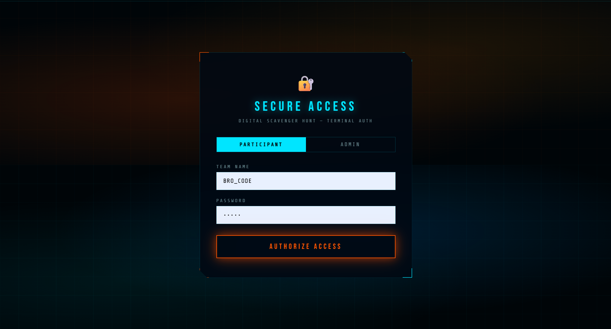
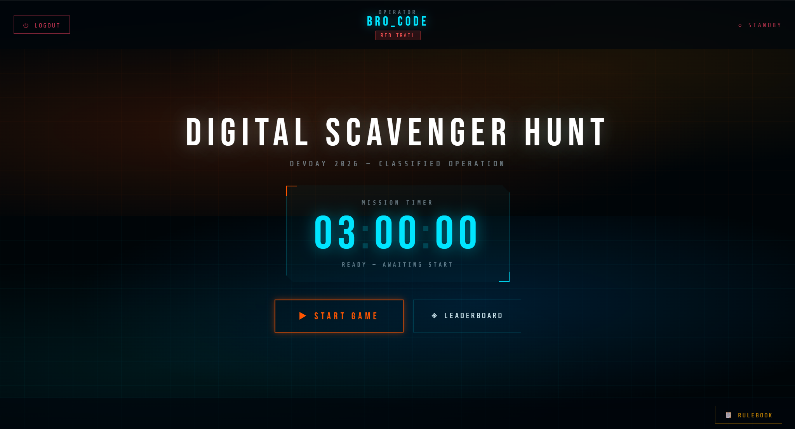
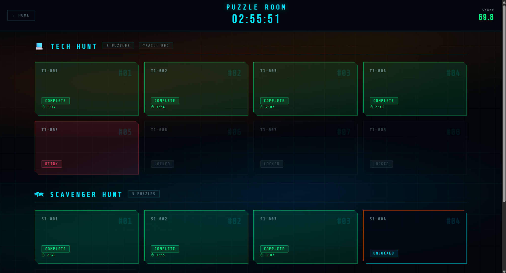
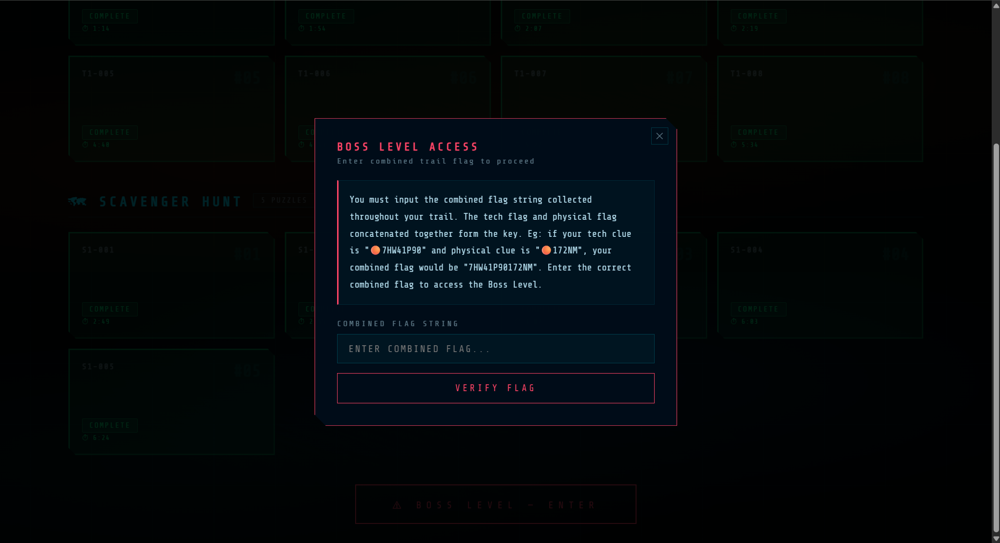
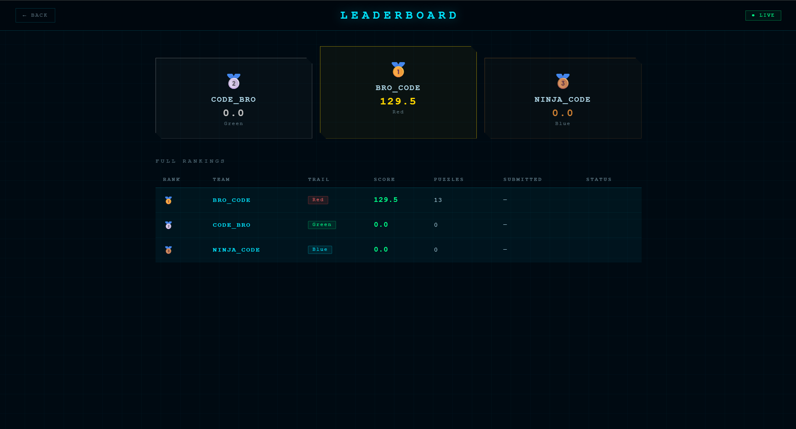

# Digital Scavenger Hunt

A live competitive scavenger hunt platform with multi-trail puzzles, progressive unlocking, and a final boss challenge driven by real-time game control.

## Overview

A full-stack web application designed to run live competitive scavenger hunt events for **DEVDAY'26 at FAST University**. Teams are assigned one of three colored trails (Red, Green, or Blue), each containing a distinct sequence of 8 technical puzzles and 5 physical puzzles sourced from a MongoDB database. Teams earn points by solving puzzles in order, collecting clue fragments, and ultimately completing a Boss Level challenge. An admin panel provides full real-time control over the game — starting and ending sessions, managing teams, editing puzzles, and monitoring a live leaderboard. Built for deployment on Render with a React frontend and an Express/MongoDB backend.

## Features

**Team & Authentication:**
- Team-based login with bcrypt-hashed passwords
- Each team is assigned a trail color (Red, Green, Blue) determining their puzzle sequence
- Admin login via environment-variable-stored credentials

**Game Flow:**
- Sequential puzzle unlocking — each correct answer unlocks the next puzzle
- 8 technical puzzles per trail (unlocked one at a time)
- 5 physical (location-based) puzzles, unlocked after completing the 3rd tech puzzle
- Boss Level: teams enter a combined flag string derived from both trail flags to access; correct final answer awards 50 bonus points
- Wrong answer penalty: −0.1 points per incorrect attempt; puzzle state resets to retry

**Puzzle Management:**
- All puzzles are stored in MongoDB with per-trail, per-type seeding via an admin initialization endpoint
- Admin can edit any puzzle (name, description, link, answer, clue) live
- Puzzle clues are displayed to the team only after a correct answer

**Scoring:**
- +10 points per correct puzzle answer
- +50 points for Boss Level completion
- −0.1 point penalty per wrong attempt
- Leaderboard sorted by: total score → puzzles solved → final submission time

**Admin Panel:**
- Start, deactivate, end, and reset game sessions
- Create new teams with trail assignment
- View all team progress in detail (puzzle states, scores, times)
- Reset timer and reset all user progress
- Full database wipe endpoint

**Timer:**
- Global game clock (3-hour default); time remaining calculated server-side from `GameStartTime`
- Timer state shared across all connected clients via polling

## Tech Stack

**Frontend:** React, React Router (HashRouter), CSS Modules

**Backend:** Node.js, Express.js

**Database:** MongoDB (Mongoose ODM)

**Auth:** bcryptjs for password hashing

**Deployment:** Render (backend + frontend)

**Environment:** dotenv

## System Design / Working

**Backend Architecture (`server.js`):**

The Express server connects to MongoDB via Mongoose and defines five main schemas: `User` (team state and puzzle progress), `Puzzle` (question content per trail/type/index), `Flag` (trail-specific flag strings for the Boss Level), `Boss` (final answer and description per trail), and `GameState` (global active/ended status and start time).

**Puzzle State Arrays:**

Each user document stores puzzle progress as numeric arrays:
- `TechPuzzleStatusArray[8]`: `0 = locked`, `1 = unlocked`, `2 = correct`, `3 = wrong`
- `PhysicalPuzzleStatus[5]`: same encoding

On a correct submission, the current puzzle is set to `2` and the next index is unlocked (`1`). Physical puzzles unlock in parallel after tech puzzle index 2 is solved. Wrong answers set the puzzle to `3` (requires a `/retry` call to re-enable).

**Scoring Logic:**

Total score is maintained in `TotalScore` on the User document, incremented per correct answer and decremented per wrong answer. The leaderboard endpoint sorts by `TotalScore`, then by puzzles solved count, then by `FinalSubmissionTime`.

**Boss Level Flow:**

Teams submit a combined flag string (tech flag + physical flag for their trail). If correct, `BossStartTime` is recorded. Teams then submit the final Boss answer; on success, `SafeStatus` is set to `true`, `FinalSubmissionTime` is recorded, and 50 points are awarded.

**Frontend Route Structure:**

```
/ (LoadingPage1) → /login → /loading (LoadingPage2)
→ /home (HomePage) → /puzzle-room (PuzzleRoom)
→ /boss-level (BossLevel) → /success or /failure
→ /leaderboard
→ /admin (AdminPanelPage)
```

## Screenshots

- "Team login screen with trail color assignment"

- "Homepage -Shows timer, and start button to access the puzzle page"

- "Puzzle room — sequential tech/physical puzzle interface with status indicators"

- "Flag entry and final challenge reveal"

- "Boss Level — final challenge submission"

- "Live leaderboard sorted by score, puzzles solved, and submission time"

- "Admin panel — team management, game control, and live progress monitoring"


## Deployment

Live Demo: [https://digital-scavenger-hunt.onrender.com/]

- Username: BRO_CODE 
- Password: 12345
- Username: NINJA_CODE 
- Password: 12345
- Username: CODE_BRO 
- Password: 12345

## How to Run Locally

```bash
# Clone the repository
git clone <repo-url>
cd DigitalScavengerHunt

# Backend setup
cd backend
npm install

# Create .env file
echo "MONGODB_URI=<your_mongo_uri>
AdminUsername=<admin_username>
AdminPassword=<admin_password>
PORT=5000" > .env

npm start

# Frontend setup (new terminal)
cd ../client
npm install
npm start
```

## Folder Structure

```
DigitalScavengerHunt/
├── backend/
│   ├── server.js         # All API routes, Mongoose schemas, game logic
│   └── package.json
└── client/
    ├── public/           # Static assets including DSH_Rulebook.pdf
    └── src/
        ├── App.js                     # Route definitions (HashRouter)
        └── components/
            ├── LoginPage.js
            ├── HomePage.js
            ├── PuzzleRoom.js          # Tech + physical puzzle interface
            ├── BossLevel.js           # Boss level flag entry and final answer
            ├── LeaderBoard.js
            ├── AdminPanelPage.js      # Full admin control panel
            ├── SuccessPage.js
            ├── FailurePage.js
            └── LoadingPage1/2.js
```

## My Role

Sole developer responsible for the complete design and implementation of the platform. 😎
